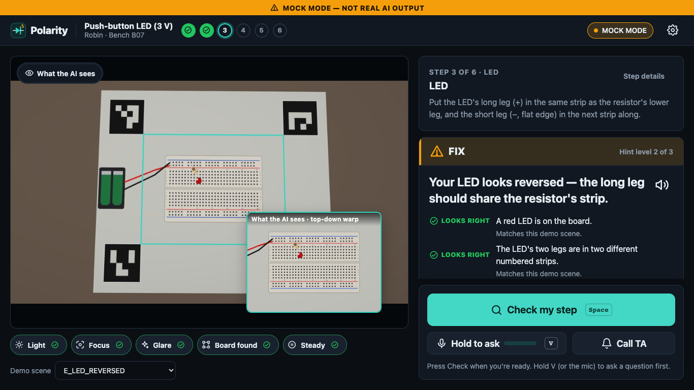

# Polarity

**An AI lab partner that catches wiring mistakes before the circuit fails, and shows the TA where the class is stuck.**

[](LICENSE)

Built for the Nebius x NVIDIA Global AI Hackathon — Physical AI track.

**Demo video:** {{YOUTUBE_URL}} <!-- TODO-TEAM: public YouTube link, under 3 minutes -->



<sub>Screenshot from demo mode (synthetic board, canned answers, hence the MOCK MODE bar). TODO-TEAM: replace with a GIF of the real rig.</sub>

## The problem

A first-year electronics student builds their first breadboard circuits in a teaching lab. Beginner wiring
mistakes stay invisible until power-on: an LED put in backwards, both resistor legs in the same strip (shorted
out), a push button that does not straddle the centre channel, battery leads swapped. When the circuit finally
fails, the student has to debug everything at once.

The TA is the bottleneck. They can only look at one bench at a time ({{TA_RATIO_CONFIRMED}}
<!-- TODO-VERIFY (humans): ask a real SIT lab TA how many students one TA supervises, and add a one-line quote.
Do not state a ratio until it is confirmed. -->), and they have no class-level view of which step everyone is
struggling with.

## What it does

- **Checks each step, not just the end result.** A camera above the breadboard and a deterministic state machine
  walk the student through the lab one step at a time. Nemotron Nano Omni returns schema-validated judgments per
  check; code, not the model, decides PASS / FIX / CAN'T TELL.
- **Says "I can't tell" honestly.** An on-device quality gate (focus, light, glare, board found, steadiness)
  answers before any cloud call. The model must mark checks `not_visible` instead of guessing, and a second, closer
  look runs when confidence is borderline. A CAN'T TELL always comes with one specific retake instruction.
- **Teaches instead of telling.** Feedback follows a hint ladder (where to look → what is wrong → exact fix),
  spoken aloud with captions always on screen. Students can hold V and ask a question about the step.
- **Trusts physics for the power test.** At power-on an on-device LED detector compares the board with a baseline
  frame. A dark LED cannot be talked into a pass.
- **Shows the TA where the class is stuck.** A live dashboard with a help queue (each request summarised by
  Nemotron Super), a steps × students heatmap, step insights and an end-of-class report from Nemotron Ultra. TAs can
  also turn any lab handout into checkable steps with the lab compiler.

## How it works


What happens when a student presses **Check** (Space):

1. The camera thread hands over the sharpest frame from the last second.
2. ArUco markers on a printed mat give a homography; the board is warped to a 1024×768 top-down view.
3. The quality gate scores focus, brightness, glare, markers and motion. If it fails: CAN'T TELL with a specific
   retake instruction, no cloud call.
4. On the power-test step, the LED detector compares the warped frame with the baseline captured when the step began.
5. One request goes to **Nemotron Nano Omni** on Token Factory: the step spec (checks, common mistakes, hint level),
   the warped image and, if the student spoke, their voice clip.
6. The reply is validated against a Pydantic schema (one repair call if needed); a deterministic policy turns it
   into PASS / PASS-with-a-double-check / FIX / CAN'T TELL. Borderline confidence triggers a zoomed second look.
7. Strong physical LED evidence overrides the model on the power test.
8. The attempt is stored, the verdict is spoken and shown with evidence, and escalation rules decide whether to
   call the TA.

More detail: [docs/ARCHITECTURE.md](docs/ARCHITECTURE.md).

## How we use NVIDIA Nemotron and Nebius Token Factory

Every perception and reasoning call goes to **Nebius Token Factory**, which is OpenAI-compatible, using **NVIDIA
Nemotron 3** models. A single `ModelRouter` maps four roles to models, so cheap and fast models handle the frequent
calls and the heavy models only run where they earn it. It applies the case policy, thinking control, JSON mode,
retries with backoff, the budget guard, and logs cost per call.

<!-- MODELS:START -->
| Role | Exact model ID on Token Factory | Case used | Measured latency (Phase 0) | Used for |
|---|---|---|---|---|
| `perception` | PENDING: run `python -m polarity verify` with a key | — | — | Step verification (top-down photo ± the student's voice clip), voice Q&A, reading lab-sheet pages, printed part markings |
| `fast_text` | PENDING | — | — | Intent of a typed question; shortening long spoken feedback |
| `reasoning` | PENDING | — | — | TA help-request summaries, assembling compiled labs, the Tavily part-lookup agent |
| `deep` | PENDING | — | — | End-of-class report for the TA |

Model IDs, latencies and capabilities are filled in automatically by `python -m polarity verify`
(evidence in [docs/PHASE0_REPORT.md](docs/PHASE0_REPORT.md)).
<!-- MODELS:END -->

**Why each model.** Nemotron 3 **Nano Omni** reads images *and* audio in one request, so a spoken question can ride
along with the photo being checked, and it reads lab-sheet pages for the compiler. **Nano 30B** is the cheap text
model for small jobs. **Super 120B** reasons over a student's attempt history for the TA, structures compiled labs,
and drives the Tavily tool. **Ultra** writes the end-of-class report with thinking enabled; it falls back to Super if
unavailable.

**A real request** (simplified from `polarity/engine/verifier.py` and `polarity/llm/router.py`):

```python
client = OpenAI(base_url=caps["base_url"], api_key=NEBIUS_API_KEY)      # Token Factory, OpenAI-compatible
client.chat.completions.create(
    model=caps["models"]["perception"]["id"],                            # exact ID discovered by `polarity verify`
    messages=[
        {"role": "system", "content": STEP_VERIFIER_SYSTEM},
        {"role": "user", "content": [
            {"type": "text", "text": json.dumps(step_spec)},              # checks, common mistakes, hint level
            {"type": "image_url", "image_url": {"url": "data:image/jpeg;base64,..."}},       # warped board
            {"type": "input_audio", "input_audio": {"data": "<wav b64>", "format": "wav"}},  # optional question
        ]},
    ],
    response_format={"type": "json_schema", "json_schema": {"name": "PerceptionVerdict", "strict": True,
                                                            "schema": PERCEPTION_VERDICT_SCHEMA}},
    extra_body={"chat_template_kwargs": {"enable_thinking": False}},     # fast, deterministic checks
    temperature=0, max_tokens=900,
)
```

**What Phase 0 verifies before we rely on anything.** `python -m polarity verify` probes the base URL, lists models,
resolves the four roles, and tests each assumption with inputs whose answers prove the modality was understood (a
board image with a red LED and the label "TEST BOARD 7"; a spoken clip with the secret word "banana"; both in one
request). It records:

- **thinking control:** whether `chat_template_kwargs` or `/no_think` turns reasoning off;
- **JSON mode:** `json_schema` → `json_object` → prompt-only, falling back automatically with a repair call;
- **tool calling:** native or manual;
- **model-ID case:** exact first, lowercase fallback, recorded per model;
- **audio mode:** the safest one, from one combined call down to browser speech recognition.

The app reads `data/capabilities.json` and adapts instead of assuming.

**Swapping models is one line.** Because Token Factory speaks the OpenAI API, roles map to model IDs. Change a role
with `POLARITY_MODEL_<ROLE>=<id>` in `.env` and nothing else changes.

**Where Token Factory accelerated our workflow.** TODO-TEAM-CONFIRM after the live Phase 0 run. Planned evidence:
one SDK and one base URL for all four Nemotron models; measured latencies from Phase 0; native JSON-schema output
removing most parsing failures. Replace with what we actually saw.

## Tavily

**Best Use of Tavily.** When a student asks about a printed part (for example "what are the pins of an NE555?"), or
the model reads a part marking on the board, Polarity makes a **runtime call to the Tavily Search API**
(`"<part> pinout datasheet"`, 5 results). Nemotron Super then summarises only what those pages say into a pinout table
with clickable sources. Native tool calling is used when Phase 0 confirms it works; otherwise our code calls Tavily and
Super summarises. Sources are filtered to the URLs Tavily returned, and results are cached per part. Without
`TAVILY_API_KEY` the feature is hidden. Code: [polarity/engine/parts.py](polarity/engine/parts.py).

## Hardware and rig

| | Minimum (works) | Recommended |
|---|---|---|
| Computer | Any macOS 13+ or Windows 10/11 laptop | Same |
| Camera | Built-in or any USB webcam, roughly top-down (phone stand, gooseneck, taped to a shelf); a phone via Continuity Camera / DroidCam / Camo also works | 1080p USB webcam on a gooseneck, 25–35 cm above the board |
| Light | Any desk lamp | Small LED ring light |
| Mat | — | The printed ArUco marker mat |

Print the marker mat from [assets/print/marker_mat_A4.pdf](assets/print/marker_mat_A4.pdf) at 100% scale and
check the 1 cm bar with a ruler. Regenerate it with `python -m polarity markers`. Lab 1 uses a half-size
breadboard, a 2×AA holder with a switch, a red LED, a 100 Ω resistor, a 6×6 mm push button and jumpers. A 5 V USB
variant is in `labs/lab1_5v.yaml`.

<!-- TODO-TEAM: photo of the rig and the marker mat here -->

## Quick start — macOS

```bash
git clone https://github.com/Clrrxx/Nebius-x-NVDIA-Submission.git polarity && cd polarity
scripts/setup_mac.sh          # Python 3.12 venv, dependencies, .env, demo scenes, doctor
# open .env and paste NEBIUS_API_KEY=... (TAVILY_API_KEY optional)
scripts/verify_mac.sh         # Phase 0: discovers model IDs, writes data/capabilities.json
scripts/run_mac.sh            # opens http://127.0.0.1:8765 (or the next free port)
```

Needs Python 3.12 (`brew install python@3.12`); 3.11 also works. The first time the camera is used, macOS asks
for permission. If it was denied, enable your terminal app (Terminal, iTerm, VS Code or Cursor) under System
Settings → Privacy & Security → Camera (and Microphone), then restart it.

## Quick start — Windows

```bat
git clone https://github.com/Clrrxx/Nebius-x-NVDIA-Submission.git polarity
cd polarity
scripts\setup_windows.bat
REM open .env and paste NEBIUS_API_KEY=...
scripts\verify_windows.bat
scripts\run_windows.bat
```

Needs Python 3.12 (`winget install Python.Python.3.12`); 3.11 also works. Allow camera access under Settings →
Privacy & security → Camera → "Let desktop apps access your camera". Chrome or Edge is recommended; Safari works
for the core flow, and speech starts after the first click.

## Demo mode (no camera, no credits)

```bash
CAMERA_SOURCE=demo POLARITY_MOCK_MODELS=1 scripts/run_mac.sh
```

```bat
set CAMERA_SOURCE=demo
set POLARITY_MOCK_MODELS=1
scripts\run_windows.bat
```

The demo camera plays synthetic boards for every step and every common mistake (pick them from the bench's "Demo
scene" menu or `/debug`). Mock models return canned answers, and every screen shows an amber **MOCK MODE — not real
AI output** bar. The TA dashboard can seed a simulated class of 28 students, always flagged as simulated. To see
real Nemotron judgments without hardware, keep `CAMERA_SOURCE=demo` and leave `POLARITY_MOCK_MODELS=0`.

## Configuration reference

| `.env` key | Default | Meaning |
|---|---|---|
| `NEBIUS_API_KEY` | — | Token Factory key (never printed in full, never committed) |
| `NEBIUS_BASE_URL` | auto | Leave blank to use the URL `verify` found |
| `POLARITY_MODEL_PERCEPTION` / `_FAST_TEXT` / `_REASONING` / `_DEEP` | auto | Override a role's model ID |
| `TAVILY_API_KEY` | — | Enables part lookup |
| `POLARITY_MOCK_MODELS` | `0` | `1` = canned answers + MOCK MODE badge |
| `CAMERA_SOURCE` | `opencv` | `opencv` or `demo` |
| `CAMERA_INDEX`, `CAMERA_WIDTH`, `CAMERA_HEIGHT` | `0`, `1920`, `1080` | Which camera and what resolution (falls back to 1280×720) |
| `MARKERS_ENABLED` | `true` | `false` uses the fixed ROI in `config/settings.yaml` |
| `AUDIO_MODE` | `auto` | `omni_combined`, `omni_separate`, `browser_stt`, `typed`; `auto` uses what Phase 0 verified |
| `DEFAULT_LAB` | `lab1` | Lab shown first |
| `PORT` | `8765` | Next free port is used if busy |
| `TA_PIN` | `2468` | Protects the TA dashboard, lab editor and debug controls. **Change it before a demo.** |
| `BUDGET_SESSION_USD`, `BUDGET_DAY_USD` | `1.00`, `5.00` | Budget guard (needs prices in `config/pricing.yaml`) |
| `MEDIA_RETENTION_DAYS` | `14` | `python -m polarity purge` deletes older media |

Thresholds (quality gate, LED detector, decision policy, timeouts, retries, escalation rules, hub sync) live in
[config/settings.yaml](config/settings.yaml). Tune them on your rig with `python -m polarity calibrate`. Per-model
prices go in [config/pricing.yaml](config/pricing.yaml). Copy them from the Token Factory console; until then cost
shows "n/a".

Commands: `verify`, `doctor`, `run`, `devices`, `markers`, `calibrate`, `capture`, `eval`, `seed-demo`, `purge`,
`render-synthetic` (`python -m polarity <command> --help`).

## Evaluation results

<!-- EVAL:START -->
**PENDING.** No real evaluation has been run yet: it needs photos from the real rig and a key. We will only report
numbers measured on real photos with `python -m polarity eval`; see [docs/EVAL_RESULTS.md](docs/EVAL_RESULTS.md)
for the method and the decision gate (false-pass ≤ 5%, selective accuracy ≥ 85%).
<!-- EVAL:END -->

## Privacy and safety

Students use nicknames; no real names are needed. Camera frames and audio stay on the bench computer. Only the frame
being checked (already warped to the board) and an optional voice clip are sent to Token Factory, at the moment the
student presses Check or asks. Stored media is deleted after `MEDIA_RETENTION_DAYS` with `python -m polarity purge`.
In hub mode, benches send records but no images unless thumbnails are switched on. See
[docs/PRIVACY.md](docs/PRIVACY.md).

Low voltage only: batteries or USB power, never mains. If anything gets hot, smells or smokes, switch off and call
the TA. Safety questions are redirected to the TA and raise an urgent help request.

## Limitations

- Fine details are hard to see from above. An LED's flat edge or a button's rotation may honestly come back as
  "double-check this yourself" (PASS · 1 thing to double-check) rather than a confident verdict.
- Solder-joint quality cannot be verified reliably by a camera above the board. The soldering template marks it for
  TA review.
- Results depend on lighting and camera placement. The quality gate catches bad photos, but a well-lit, steady rig
  matters.
- Each check is a cloud call (typically a few seconds). The edge does everything it can for free first.
- Accuracy is unmeasured until the evaluation dataset is captured (see above).

## Roadmap

Any lab sheet → verifiable steps for more courses (the compiler is in place); Jetson Orin Nano / Raspberry Pi 5
bench units (see [docs/EDGE_DEVICES.md](docs/EDGE_DEVICES.md)); soldering and multimeter labs; multilingual voice; TA
resolve actions flowing back to benches in hub mode.

## Project structure

```
polarity/
  cli.py            commands (verify, doctor, run, eval, capture, calibrate, seed-demo, …)
  config.py         .env + config/settings.yaml + data/capabilities.json; APP_NAME
  verify/           Phase 0 Token Factory verification
  llm/              client, model resolver, ModelRouter, prompts, JSON handling, mock answers
  edge/             camera, ArUco board locator, quality gate, motion, LED detector, marker mat, rig tools
  engine/           session state machine, check pipeline, decision policy, voice Q&A, TA diagnosis, class
                    report, lab compiler, Tavily part lookup, board audit, analytics, evaluation harness
  storage/          SQLite (WAL) + local media
  hub/              bench → hub sync
  demo/             synthetic boards, step illustrations, sample handout, seeded class
  web/              FastAPI app, WebSocket events, templates, CSS, vanilla JS (no build step)
labs/               lab definitions (YAML) + sample handout
config/             settings.yaml, pricing.yaml
scripts/            setup / run / verify for macOS (.sh) and Windows (.ps1 + .bat)
docs/               architecture, decisions, Phase 0 report, eval results, demo script, Devpost draft, feedback, privacy
tests/              pytest suite (mock models, demo camera, no network)
```

## Team

| Name | Role |
|---|---|
| TODO-TEAM | |
| TODO-TEAM | |
| TODO-TEAM | |

## License

MIT. See [LICENSE](LICENSE).
