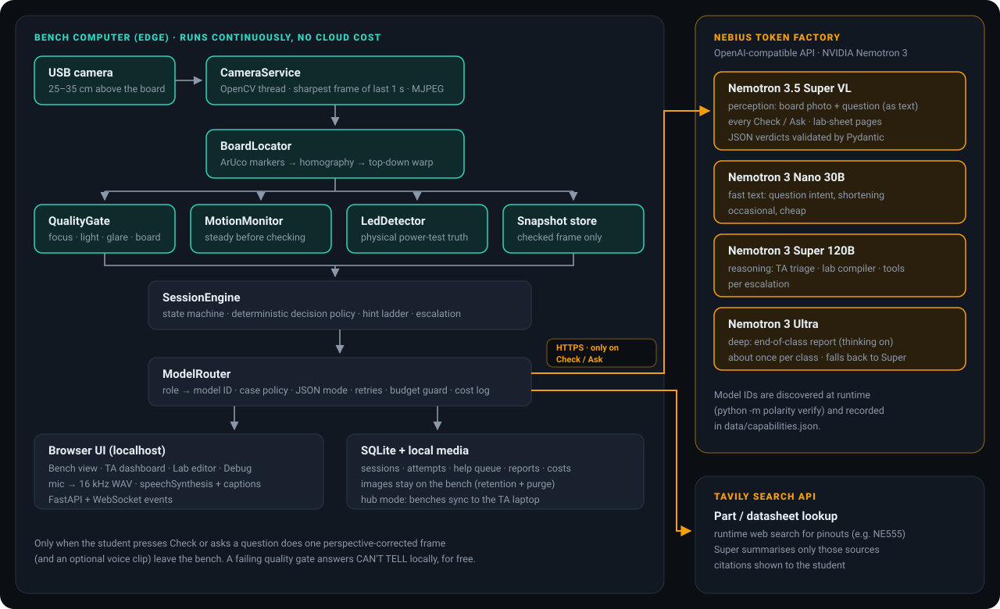
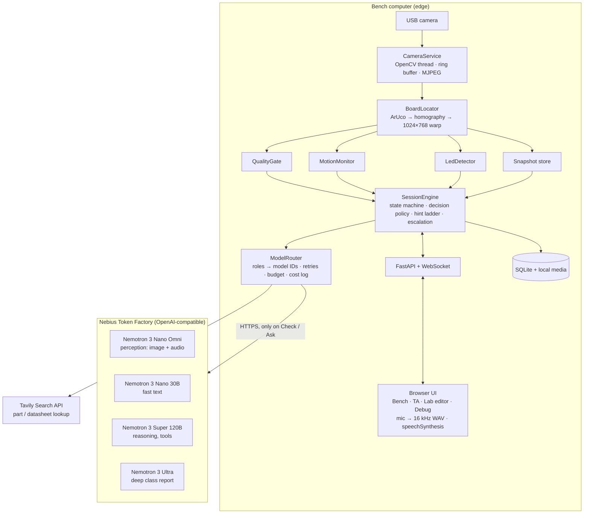

# Architecture

Polarity is one Python process per bench: a FastAPI server, a camera thread, an edge-monitor thread and a
browser UI on `localhost`. Perception that can run on the bench runs continuously and for free. The cloud
(Nebius Token Factory) is called only when a student presses **Check** or asks a question, and only after the
on-device quality gate has accepted the image.

## Edge vs cloud

| Runs on the bench, continuously, no cost | Runs in the cloud, only on demand |
|---|---|
| Camera capture, sharpest-frame ring buffer | Step verification (Nano Omni): one call per Check |
| ArUco board localisation + top-down warp | Voice / typed questions (Nano Omni) |
| Quality gate (focus, light, glare, markers, motion) at 2 Hz, shown as live chips | Question intent, shortening (Nano 30B) |
| LED-lit detector for the power test | TA help summaries, lab compiler, Tavily agent (Super) |
| Deterministic decision policy, hint ladder, escalation | End-of-class report (Ultra, falls back to Super) |

## The check pipeline

Code: `polarity/engine/verifier.py`, `polarity/engine/decision.py`, `polarity/engine/session_engine.py`.

1. Take the sharpest frame from the last ~1 s of the ring buffer.
2. Warp the board to 1024×768. With three markers visible, the fourth corner is inferred from a homography fitted to
   all twelve detected marker corners.
3. Quality gate. On failure the result is CAN'T TELL with one specific retake instruction (too dark, glare, blur,
   markers hidden, hands moving) and no cloud call.
4. Power-test step only: the LED detector compares the frame with a baseline captured when the step started. It
   excludes skin, ignores elongated red shapes such as wires, and refuses to give "strong" evidence when the LED
   looks covered or the baseline looks wrong.
5. Perception call to Nano Omni with the verifier prompt, the step spec and the warped JPEG, plus the student's voice
   clip when the verified audio mode allows it.
6. Pydantic validation, with one repair call on invalid JSON. If the output is still invalid: CAN'T TELL
   (`model:invalid_output`), never a crash.
7. Deterministic decision:
   - FIX needs a failed check at confidence ≥ 0.60;
   - PASS needs every required check passed at confidence ≥ 0.75;
   - PASS-with-a-double-check is allowed only when the missing checks are marked `allow_uncertain`;
   - an error id with no failed check is treated as inconsistent and becomes CAN'T TELL;
   - strong LED evidence overrides the model on the power test.
8. Confidence in the grey zone (0.50–0.80) triggers a second look: a 1.6× re-warp from the full-resolution frame,
   centred on the model's evidence region. If the two looks disagree, the result is CAN'T TELL.
9. Persist the attempt (images, audio, verdict, model, latency, cost). Advance on a pass; raise the hint level on a
   FIX. Escalate to the TA on 3 FIXes, 3 CAN'T TELLs in a row, 2 failed power tests, a safety redirect, or "Call TA".

## Capability-adaptive behaviour

`python -m polarity verify` writes `data/capabilities.json`. The router and verifier read it instead of assuming:

| Capability | Values | Effect |
|---|---|---|
| Audio mode | `omni_combined` / `omni_separate` / `browser_stt` / `typed` | Voice clip in the same call, transcribed first, recognised in the browser, or typed |
| JSON mode | `json_schema` / `json_object` / `prompt_only` | Strict schema, JSON object, or schema in the prompt plus repair; a 400 downgrades it automatically |
| Thinking control | `chat_template_kwargs` / `system_flag` / `none` | Thinking off for interactive roles; larger token budget if it cannot be turned off |
| Tools | `native` / `manual` | Super calls `lookup_part` itself, or our code calls Tavily first |
| Model-ID case | `exact` / `lowercase` per model | Exact ID first, lowercase fallback on "model not found" |

## Data

SQLite in WAL mode (`data/polarity.db`) holds sessions, attempts, help requests, reports, model calls (role, model,
latency, tokens, estimated cost), the part cache and the hub outbox. Images and audio live under
`data/media/<session_id>/` and are purged after `MEDIA_RETENTION_DAYS`.

## Module map

| Package | Responsibility |
|---|---|
| `polarity/verify` | Phase 0 probe (T0–T12), test assets, report and capabilities file |
| `polarity/llm` | OpenAI client, model resolver, `ModelRouter`, prompts, JSON extraction/repair, mock answers |
| `polarity/edge` | Camera sources, board locator, quality gate, motion, LED detector, marker mat, capture/calibrate tools |
| `polarity/engine` | Session engine, verifier, decision policy, voice Q&A, diagnosis, report, analytics, lab compiler, parts, board audit, evaluation |
| `polarity/storage` | SQLite repository and media store |
| `polarity/hub` | Bench → hub outbox sync |
| `polarity/web` | FastAPI app, event bus, templates, CSS, vanilla JS |
| `polarity/demo` | Breadboard geometry, synthetic scenes, step illustrations, sample handout, seeded class |
